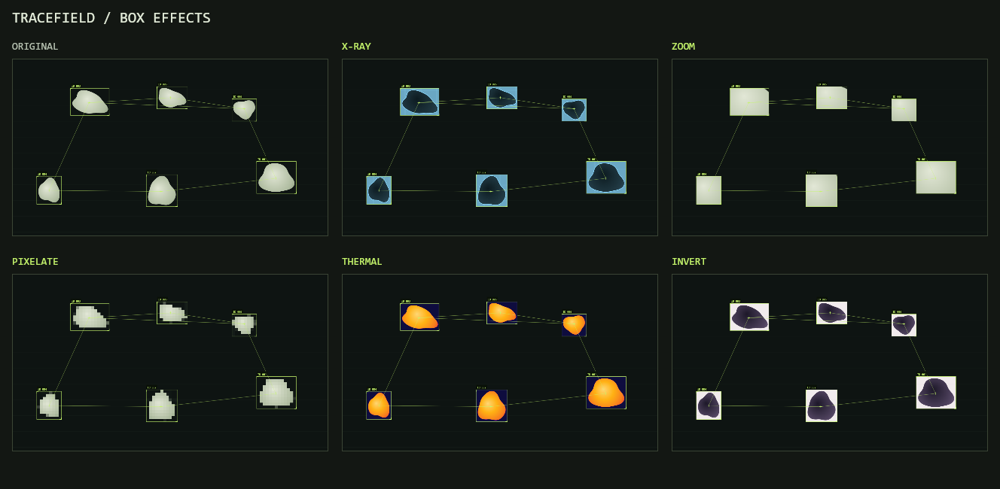

# Tracefield

Designed by [Nikolaos Mavros (mavroul1s)](https://github.com/mavroul1s).

**[Open the app →](https://mavroul1s.github.io/tracefield/)**

Start using it directly in your browser. No download, installation, or Node.js required.

A browser tool for a TouchDesigner-style blob tracking overlay. Drop in a video, tune detection, and export boxes, persistent IDs, center points, connections and trails.

Boxes, connections, and points / IDs can use their own colors. Enable **Separate colors** in Overlay, then use each color picker or enter a hex color. Turn it off to use one shared line color. Motion trails follow the point color.

Enable **Box effects** in Overlay to open **X-ray**, **Zoom**, **Pixelate**, **Thermal**, and **Invert**. Select one or several effects to change the video inside every tracked box. Zoom magnifies the center by 2×; X-ray and Thermal use artistic luminance palettes. Combinations apply zoom, pixelation, X-ray, thermal, then inversion. The choices carry across presets and are included in PNG snapshots and MP4 exports. Reset turns box effects off.

## Run locally

Download [blob-tracker.html](blob-tracker.html) and double-click it to open in Chrome or Edge. Everything needed for the interface, tracker, and export is included in this one file. No Node.js, installation, API key, or server is required.

Compatible videos work offline. Unsupported codecs such as Motion JPEG MOV need an internet connection to download the browser conversion engine (31 MB). Conversion still runs on your device; your video is never sent to an external service.

Developers can optionally run `node server.mjs` and open http://127.0.0.1:5173 for faster native conversion. Rebuild the standalone file after editing `dist/` with `npm run build:standalone`; the generated HTML is committed so users do not need a build step.

## Use

1. Upload or drag in your video. Unsupported codecs are converted automatically.
2. Select Bright areas, Dark areas, or Moving areas. Motion detection works best with a static camera.
3. Open Detection mask and tune Threshold / Minimum blob size.
4. Adjust the overlay and colors, then export video or save a PNG frame.

Processing stays on the device. Unsupported codecs (including Motion JPEG MOV) are converted automatically to H.264 / AAC MP4. The optional local server uses FFmpeg when installed; standalone and hosted copies use a single-thread WebAssembly worker. Browser conversion supports files up to 500 MB; the local helper up to 1 GB. Conversion preserves the aspect ratio and prepares footage at up to 1080p. Compatible source clips do not need conversion.

For native local conversion, install `imageio-ffmpeg` into `.local-tools/python` with `python -m pip install --target .local-tools/python imageio-ffmpeg`. The bundled Windows executable is discovered automatically. The original video is untouched and temporary conversion files are removed after the response. `BLOB_TRACKER_FFMPEG` can point to another installed FFmpeg executable.

Uploads are checked for decoded video dimensions, so an audio-only playback success cannot produce a black export with stale demo tracking. Detection is automatically tuned on upload; Original / Effect / Mask views make the source and output easy to compare.

Video export processes every frame with WebCodecs and produces a regular, fast-start H.264 MP4 at a constant 30 FPS. Rendering waits for the detector and encoder instead of dropping frames when the device is busy. Video bitrate is bounded between 4 and 24 Mbps, with key frames every second for easier seeking on phones such as the Pixel 10. Compatible AAC-LC sound is preserved; other audio is converted to AAC, using the local browser converter if the browser has no AAC encoder. Keep the tab open until export finishes; rendering can take longer than playback on slower devices. Export resolution can be 720p, 1080p, or original up to 4K, without upscaling the source. Source footage with low frame rates or existing freezes retains those limitations.

Detection uses luminance or background difference, connected components, and centroid matching. It is an artistic effect, not semantic object recognition. IDs can change on occlusion, overlap, large cuts or sudden motion. Higher Detection detail improves small blobs at the cost of processing speed.

The built-in animated demo runs through the same detector as uploaded footage.

## Verification

`npm test` checks detection, motion, noise filtering, ID matching, automatic tuning, decoded-video validation, and the export profile. `npm run check` checks all application modules. The standalone build includes [Mediabunny 1.61.6](dist/vendor/README.md), with its MPL-2.0 notice and license; it needs no npm installation to run.

For the optional native integration check, set `BLOB_TRACKER_TEST_FFMPEG` to an FFmpeg executable and `BLOB_TRACKER_TEST_CANVAS` to an installed `@napi-rs/canvas` module, then run `npm test`. This tests the actual export and muxing pipeline with native codec adapters: slow rendering, 30 FPS timestamps, AAC audio, audio disabled, the audio fallback, and cancellation. It does not replace testing browser WebCodecs or playback on a physical phone.
